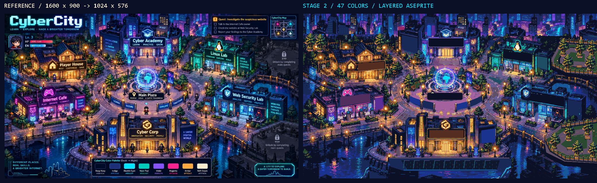

# CyberCity world map — review akhir Tahap 2

Tanggal: 26 Oktober 2026. Branch: `feature/gameplay-revision`.

**Status: aset Tahap 0–2 tersedia untuk review. Berhenti sebelum Tahap 3 sesuai instruksi pengguna.** Integrasi Unity, collision runtime, animasi air/unlock, teks TMP, dan verifikasi playthrough belum dikerjakan.

## Hasil yang tersedia

- `ArtSource/world/world.aseprite`: 1024×576, RGB, satu frame, 11 layer visual dan dua layer panduan tersembunyi.
- Enam bangunan, globe/plaza, jalan, dua jembatan utama dan sungai mempertahankan koordinat gambar referensi dengan skala seragam.
- Dua area gelap kanan diganti taman berpagar dengan pohon, bangku, lampu dan dinding penahan. Tidak ada ikon area masa depan, gembok “???”, atau tulisan “COMING SOON” pada preview.
- HUD, judul, kartu pemain, quest/minimap, kotak palet dan teks sudut dihapus. Papan nama, tagline fasad dan banner utama dibuat polos untuk teks Unity yang dapat dilokalkan.
- Seluruh ekspor akhir peta dibuat melalui MCP Aseprite. Python/Pillow/NumPy dipakai untuk preprocessing, masking dan pengukuran. Tidak menggunakan `run_lua_script`, image generator, package Unity baru, atau kode jaringan game.

## Skala dan ukuran

Karakter pemain referensi diukur pada kotak `[756,507]–[788,550)` dalam gambar 1600×900: tinggi sekitar **43 px**, ketidakpastian sekitar ±2 px akibat bayangan/tepi JPEG. Builder aktual ternyata memakai frame **24×32**, bukan 32×32; alpha karakter pertama berada pada `[3,4]–[21,31)`, tinggi **27 px**. Padding menjadi 32×32 perlu dilakukan pada tahap integrasi tanpa membesarkan gambar karakter.

| Pilihan | Skala X/Y | Tinggi karakter referensi setelah skala | Selisih terhadap 27 px | Bentuk |
|---|---:|---:|---:|---|
| Default 1280×704 | 0,8 / 0,78222 | 33,64 px | +24,58% | Tertekan vertikal 2,22% |
| **Dipilih 1024×576** | **0,64 / 0,64** | **27,52 px** | **+1,93%** | Rasio 16:9 tetap |

Skala ideal menurut tinggi terlihat adalah 27/43 = 0,62791. Ukuran 1024×576 adalah kelipatan tile terdekat yang mempertahankan 16:9: **32×18 tile, PPU 32**. Pembulatan koordinat skala paling banyak sekitar 0,5 px per sumbu.

Kontrak integrasi setelah persetujuan: `PixelPerfectCamera` 1024×576, pusat dunia `(16,-9)`, batas pemain x 0,5–31,5 dan y −17,5–−0,5. Spawn referensi kaki pemain `(771,550)` menjadi `(493,352)`, kira-kira Unity `(15,42,-11)`. Builder, WorldCamera, PlayerController, ProgressStore, fallback/reset spawn dan VerifyReachability harus berubah bersama. Tata HUD juga perlu disesuaikan agar peta utuh tetap terlihat. Tidak satu pun perubahan runtime ini diklaim sudah terpasang.

## Kemiripan terukur

| Cakupan | SSIM luminance | MSE RGB (0–255) | RMSE RGB | Piksel MSE |
|---|---:|---:|---:|---:|
| Seluruh peta | **0,615653** | **1788,3947** | 42,2894 | 589.824 |
| Tanpa dua area kanan yang diganti | **0,655775** | **1690,2993** | 41,1132 | 545.721 |

Dua mask penggantian mencakup **44.103 px / 7,4773%** kanvas. Mask dapat diperiksa di `ArtSource/world/_checks/replacement-mask.png`; koordinatnya ada pada `world-manifest.json`. Untuk SSIM, mask diperlebar 5 px agar jendela pengukuran tidak menyentuh daerah yang dikecualikan.

Metode: referensi di-resize BOX ke 1024×576; SSIM memakai luminance Rec.709, Gaussian 11×11 sigma 1,5, population variance, K1 0,01, K2 0,03 dan rentang 255. Lima piksel tepi tidak menjadi pusat jendela SSIM. MSE dihitung langsung pada RGB. **HUD dan teks asli tetap termasuk pada baseline**, sehingga penghapusannya ikut menurunkan skor. SSIM bukan persentase kecocokan dan tidak membuktikan gameplay atau collision.

Registrasi patch lokal mencari translasi ±32 px dengan MSE RGB terendah:

| Landmark | Pergeseran X/Y terbaik | Dalam tile 32 px |
|---|---:|---:|
| Emblem Cyber Academy | 0 / 0 px | 0 |
| Gable Player House | 0 / 0 px | 0 |
| Emblem Internet Cafe | 0 / 0 px | 0 |
| Penguin Linux Lab | 0 / 0 px | 0 |
| Perisai Web Security Lab | 0 / 0 px | 0 |
| Emblem Cyber Corp | 0 / 0 px | 0 |
| Globe plaza | 0 / 0 px | 0 |
| Lengkung jembatan barat | 0 / 0 px | 0 |
| Pagar jembatan tenggara | 0 / 0 px | 0 |

Hasil tersebut mendukung kecocokan posisi landmark, bukan pembuktian bahwa seluruh kontur atau ukuran bangunan identik. Bangunan diekstrak pada koordinat sumber tanpa perubahan skala individual. Kontur mask digambar manual dan beberapa tepian/cornice dirapikan kembali melalui MCP.

## Palet, layer, dan tile

Ekstraksi MCP dengan batas 40 menghasilkan 39 warna; delapan warna merek ditambahkan menjadi **47 warna**. PNG final memakai tepat 47 warna, **0 warna di luar palet**, dan seluruh warna merek benar-benar muncul: `#0B1026 #1F2A6B #00E5FF #00D4B7 #8B5CF6 #FF2D9B #FFB347 #FFF4D6`.

Layer visual: `ground`, `water`, `scenery_edge`, `buildings_academy`, `buildings_player_house`, `buildings_internet_cafe`, `buildings_linux_lab`, `buildings_web_lab`, `buildings_cyber_corp`, `props`, `glow`.

`reference_trace` dan `guide_collision` disimpan tersembunyi dan tidak ikut ekspor. Semua layer visual memiliki piksel nyata; alpha PNG layer biner 0/255. Ground berisi 589.824 piksel opaque, termasuk underpainting di belakang objek. Gabungan PNG layer diuji identik dengan preview final.

Kanvas memuat **576 sel**. Analisis ground saat ini menemukan **308 potongan 32×32 unik** sebelum optimasi. **Tileset runtime yang telah diekspor: 0**; slicing/deduplication Builder adalah Tahap 3. Air masih satu frame pada sumber utama; 2–4 frame refleksi akan dibuat pada Tahap 3.

## Perbedaan visual dan batas kualitas

1. **Taman kanan merupakan perubahan disengaja**, dengan paving lebih sederhana dan susunan pohon lebih teratur daripada detail ilustrasi asli. Pagar tertutup memberikan petunjuk area non-interaktif; collider fisiknya belum ada.
2. **Bagian yang tertutup HUD tidak dapat dipulihkan persis.** Skyline kiri/kanan atas memakai kloning tekstur dan beberapa siluet yang digambar ulang. Dinding kanal bawah Cyber Corp direkonstruksi; sudut bawah diisi air dari bagian lain referensi. Area ini dapat berbeda jauh lebih dari satu tile dalam isi detail karena gambar sumbernya memang tertutup UI.
3. **Papan polos merupakan persiapan lokalisasi.** Tulisan nama dan tagline akan ditambahkan sebagai TMP di Unity setelah persetujuan. Ikon fasad non-teks tetap dipertahankan.
4. **Cahaya lebih bertingkat.** Kuantisasi 47 warna mengubah glow lembut menjadi kelompok warna tajam. Lapisan glow memisahkan piksel emissive bangunan, tetapi efek runtime bloom tidak ditambahkan.
5. **Detail masih berasal dari ilustrasi yang dikuantisasi**, dengan perapian manual pada papan, cornice, pintu, beberapa workstation, pagar, taman dan dinding kanal. Ini bukan redraw setiap piksel secara manual. Tekstur kecil masih lebih ramai daripada pixel art yang seluruh cluster-nya digambar tangan.
6. Karakter besar bawaan referensi dihapus. Beberapa bagian bekasnya disusun ulang menjadi kaca, workstation atau paving; transisi permukaannya lebih sederhana daripada sumber.
7. Pemisahan bangunan menyertakan sebagian taman fondasi/vegetasi yang menempel. Alpha/crop props dan footprint perlu ditinjau lagi saat slicing Tahap 3 agar seluruh Y-sorting benar pada runtime.
8. `lint_sprite` ground: tidak ada komponen alpha terlepas atau piksel alpha tunggal; terdapat **15.534 isolated-color/orphan warnings**, termasuk tekstur underpainting berulang yang tertutup objek dan detail ilustrasi. Jadi ini **bukan** klaim zero-warning lint pixel art. Pemeriksaan visual native-scale dan pembatasan palet lulus.

## Integrasi misi yang dipertahankan

| Bangunan | Fungsi | Syarat area dari logika yang ada |
|---|---|---|
| Cyber Academy | Professor Byte, orientation/graduation | completed ≥ 0 |
| Internet Cafe | Alex, Maya, Detective Byte; awareness/phishing/fake-site/final | completed ≥ 1 |
| Linux Lab | SysAdmin Tux; linux-ctf | completed ≥ 4 |
| Web Security Lab | Red/Blue; idor/xss/sqli/blue-soc | completed ≥ 5 |
| Player House | Dekorasi | Tanpa lock/interaksi |
| Cyber Corp | Dekorasi | Tanpa lock/interaksi |

Angka ini adalah kontrak dari `CampaignLoader.UnlockForArea`, bukan implementasi unlock baru. Threshold NPC tetap berasal dari `UnlockForNpc` dan berbeda menurut misi. Tahap 4 harus memakai event penyelesaian misi untuk tint/lock overlay/glow/toast, mempertahankan pesan “still locked”, interaksi 1,65 unit dan penanda NPC emas, serta menambahkan tujuan aktif pada peta M. Jalan tidak boleh dikunci.

## File dan provenance

| File/folder | Isi |
|---|---|
| `ArtSource/world/world.aseprite` | Sumber utama layered |
| `ArtSource/world/ref_clean.aseprite`, `ref_clean.png` | Pembersihan dan basis tracing |
| `ArtSource/world/tree.aseprite` | Pohon referensi yang dipotong dan dirapikan lewat MCP |
| `ArtSource/world/comparison.aseprite` | Sumber gambar side-by-side |
| `ArtSource/world/world_preview.png` | PNG final Tahap 2 dari MCP |
| `ArtSource/world/palette.json`, `scale.json` | Palet dan keputusan ukuran |
| `ArtSource/world/world-manifest.json`, `collision-guide.json` | Peran, bounds, pintu/pivot rencana dan panduan collision |
| `ArtSource/world/similarity-metrics.json`, `stage2-validation.json` | Ukuran selisih dan hasil validasi |
| `ArtSource/world/preprocess_reference.py`, `preprocess_tree.py`, `segment_layers.py` | Preprocessing referensi; tidak menghasilkan aset Unity |
| `ArtSource/world/measure_similarity.py`, `verify_stage2.py` | Pengukuran dan pemeriksaan ekspor |
| `ArtSource/world/aseprite-edit-log.json`, `aseprite-refinement-log.json` | Catatan operasi gambar MCP |
| `ArtSource/world/_checks/`, `_preprocess/` | Bukti pemeriksaan dan intermediate, bukan aset runtime |
| `ArtSource/world/_old/` | Snapshot aset lama dan sumber lama yang dipindahkan keluar Assets |
| `Documentation/Screenshots/world-stage2-preview.png` | Preview; bukan screenshot Game View |
| `Documentation/Screenshots/world-stage2-side-by-side.png` | Referensi vs hasil |

**Insiden referensi:** panggilan awal `extract_palette` diarahkan ke JPEG asli. Tool ini menjalankan `saveAs`, sehingga JPEG input terenkode ulang sebelum salinan kerja dibuat. Tidak ada snapshot byte-identik sebelum panggilan tersebut. Semua suntingan berikutnya memakai salinan kerja/sumber baru. Hash referensi yang tersimpan: `0B11437D7E443FA04A78D5909196D14FEBFFE16CA0A38A6D93C4F14C934C208E`. Skor di atas memakai baseline tersebut; jangan menganggapnya pembandingan byte-identik terhadap file sebelum tugas.

Mutator MCP menyimpan `.aseprite` secara eksplisit dalam batch mode; file diperiksa di disk setiap pass. Aset runtime lama tidak ditimpa: sumber Aseprite lama dipindahkan ke `_old`, snapshot lengkap dibuat, dan PNG/prefab lama tetap aktif sampai penggantian Builder disetujui. Perubahan lokal pengguna pada `ProjectSettings.asset` tidak dimasukkan ke commit peta.

## Verifikasi dan pekerjaan yang menunggu

Validasi artefak mencakup header Aseprite 1024×576/RGB/1 frame, layer/cel wajib, alpha biner, palet/warna merek, rekonstruksi composite, kesamaan dua ekspor preview, dan registrasi sembilan landmark. Ini tidak menggantikan verifikasi Unity.

- [x] Tahap 0: alat diuji, source lama dicadangkan, skala diukur.
- [x] Tahap 1: referensi dibersihkan/di-repaint, palet diekstrak, ref_clean diekspor.
- [x] Tahap 2: layer terpisah, perapian MCP, preview, side-by-side, metrik dan laporan untuk review.
- [ ] Persetujuan pengguna terhadap hasil visual ini.
- [ ] Tahap 3: tileset, sprite/props terpotong dengan pivot bawah, glow per bangunan, animasi air, importer Builder.
- [ ] Tahap 4: scene baru, clamp/kamera/HUD, NPC, collider, TMP, event unlock, penanda M.
- [ ] Tahap 5: Verify core systems, Verify complete playthrough, jangkauan seluruh pintu/NPC, matriks completed 0–11, screenshot Game View 1920×1080 terkunci/terbuka/unlock.

Commit tahap 0: `99b3a33`. Commit tahap 1: `1cec766`. Commit tahap 2 berjudul `art(world): prepare layered map preview and measured review`. Tidak ada push ke main atau branch lain.
