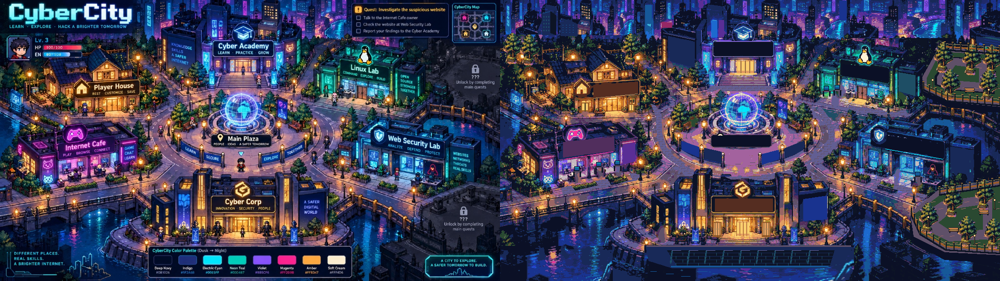

# CyberCity world map — hasil integrasi

Branch: `feature/gameplay-revision`. Tahap 2 disetujui pengguna, dilanjutkan dengan permintaan jalan sedikit lebih lebar.

## Hasil

Builder kini membuat Tilemap tanah, enam bangunan, 33 kelompok prop, air tiga frame, papan nama TMP, collision dan empat area misi. Jalan sekitar plaza serta depan pintu diperlebar **8–12 px (0,25–0,375 tile)** melalui tool gambar MCP Aseprite. Bangunan, globe dan jembatan tidak digeser.

Dua area “???” di kanan menjadi taman berpagar non-interaktif. Player House dan Cyber Corp tetap dekorasi tanpa misi atau gembok. Skyline, air, pagar, seawall dan collider menutup batas dunia. Tidak ada area coming soon.

## Skala

Karakter referensi 1600×900 terlihat setinggi **43 ±2 px**, pada kotak [756,507]–[788,550). Karakter game sebelumnya ber-frame 24×32, dengan alpha 18×27. Builder sekarang memberi padding menjadi **32×32**, tanpa memperbesar tubuh karakter.

| Kanvas | Skala X/Y | Tinggi karakter referensi setelah skala | Selisih dari 27 px |
|---|---:|---:|---:|
| Default 1280×704 | 0,8 / 0,78222 | 33,64 px | +24,58% |
| **Dipilih 1024×576** | **0,64 / 0,64** | **27,52 px** | **+1,93%** |

Skala ideal 27/43 = 0,62791. Kanvas dipilih sebagai kelipatan tile terdekat yang mempertahankan 16:9: **32×18 tile, PPU 32**. Pusat (16,−9), spawn (493/32,−352/32) = (15,40625,−11), clamp x 0,5–31,5 dan y −17,5–−0,5.

WorldLayout menyatukan dimensi/spawn/clamp untuk Builder, PlayerController, ProgressStore, reset dan verifikasi. Kanvas tetap 1024×576; **referensi PixelPerfectCamera 1344×704** menyertakan ruang HUD saat memilih zoom integer. Lebar minimum 1024/0,78 = 1312,82 dibulatkan ke tile berikutnya (1344); tinggi 576/(778/900) = 666,32 dibulatkan menjadi 704. Kamera tetap dengan offset ke ruang kiri HUD, tanpa scrolling. URP mereset partial Camera.rect, sehingga framing memakai posisi kamera. Player bawaan tetap 1600×900; bukti Game View memakai 1920×1080.

## Kemiripan terukur

Metrik memakai PNG peta tanpa HUD Unity, semua glow menyala, setelah jalan diperlebar. **SSIM bukan persentase kecocokan.**

| Wilayah | SSIM luminance | MSE RGB (0–255) | RMSE RGB |
|---|---:|---:|---:|
| Seluruh peta | **0,604768** | **1815,8163** | 42,6124 |
| Tanpa dua taman pengganti kanan | **0,643908** | **1719,9370** | 41,4721 |

Mask penggantian mencakup **44.103 px / 7,4773%** kanvas. Pelebaran jalan mengubah 7.146 piksel (1,2115%) dari preview yang disetujui. SSIM seluruh peta sebelum pelebaran adalah 0,615653; versi itu tetap dicadangkan dalam `_old/stage2-approved/`.

Metode: resize BOX ke 1024×576; SSIM luminance Rec.709, Gaussian 11×11 sigma 1,5, population variance, K1=0,01, K2=0,03, rentang 255. Pusat jendela mengabaikan 5 px tepi; mask taman diperlebar 5 px untuk SSIM. MSE langsung pada RGB. **HUD/teks asli tetap pada baseline**, sehingga penghapusannya ikut menurunkan skor.

Registrasi patch ±32 px menghasilkan translasi terbaik **0 px / 0 tile** pada sembilan landmark: emblem Academy, gable House, emblem Cafe, penguin Linux, perisai Web, emblem Corp, globe, lengkung jembatan barat dan pagar jembatan tenggara. Bangunan tidak mengalami scaling individual. Ini mendukung kecocokan layout ±1 tile, bukan pembuktian setiap kontur identik.

## Aset dan pipeline

- **47 warna**, seluruh delapan warna merek hadir, 0 warna di luar palet pada preview.
- **308 tile unik dari 576 sel**, atlas 512×640; indeks disimpan dalam world.json.
- Enam bangunan dan 33 kelompok prop memakai pivot tengah bawah dan SortingGroup `round(-y*32)+1`. Glow/sign berada dalam grup bangunan yang sama.
- Enam PNG glow, satu scenery, air 3072×576 dengan 3 frame (100/220/220 ms), gembok yang dislice menjadi ikon dan dua pecahan.
- Rekonstruksi tile serta gabungan ekspor terhadap preview: **0 piksel berbeda**.
- Seluruh PNG peta dibuat/diedit/diekspor melalui MCP Aseprite. Python hanya preprocessing, metadata dan pengukuran. Tidak memakai run_lua_script/image generator.
- Importer: PPU 32, Point, tanpa mipmap/kompresi, NPOT None. Sumber .aseprite hanya di ArtSource.
- Font/shader TMP berasal dari Essential Resources UGUI yang sudah terpasang. **Packages/manifest.json dan packages-lock.json tidak berubah.** Tidak ada kode jaringan game baru.

Sumber utama tetap memuat ground, water, scenery_edge, enam buildings_*, props dan glow. reference_trace/guide_collision tersembunyi dan tidak diekspor. Animasi air berada pada water.aseprite; sumber cropped per objek berada dalam sprites/.

## Misi dan interaksi

| Area | Fungsi | Bangunan terbuka |
|---|---|---|
| Cyber Academy | Professor Byte; orientation/graduation | completed ≥ 0 |
| Internet Cafe | Alex, Maya, Detective Byte; awareness/phishing/fake-site/final | completed ≥ 1 |
| Linux Lab | SysAdmin Tux; linux-ctf | completed ≥ 4 |
| Web Security Lab | Red/Blue; idor/xss/sqli/blue-soc | completed ≥ 5 |
| Player House, Cyber Corp | Dekorasi | Tidak memiliki lock |

WorldArea membaca CampaignLoader.UnlockForArea dan Progress.completed. NPC tetap memakai UnlockForNpc/Citizen.unlockAfter: mentor berikutnya dapat masih terkunci setelah bangunannya terbuka. Pintu meneruskan interaksi ke mentor tujuan dalam area itu, atau mentor pertamanya; pesan “still locked” tetap melalui CyberCityGame.Interact. Radius tetap 1,65 unit.

Bangunan terkunci memakai tint gelap, glow mati dan gembok. Event penyelesaian misi mengubah status; animasi pecah gembok/tint/glow/toast ditampilkan sesudah debrief ditutup agar terlihat. Tidak ada polling akses per frame atau collider jalan yang berubah mengikuti progres. NewPatrol mengembalikan status awal; load tidak memutar animasi unlock.

Collider mengikuti dasar bangunan; pemain dapat berjalan di belakang dan tertutup oleh Y-sort. Taman, kanal dan batas bersifat statis. Penanda emas NPC dipertahankan; peta M menunjuk bangunan misi aktif. Nama NPC tampil saat menjadi tujuan/terdekat untuk mengurangi tumpang tindih.

## Verifikasi

Art import dan scene contract lulus. Verify core systems lulus **169 checks**. Run final Verify complete playthrough pada 27 Oktober 2026 lulus **298 checks**, melalui UI seluruh 11 misi, animasi unlock, penanda M dan input E di pintu Cafe saat misi Maya. BFS memeriksa collider scene pada grid 0,5 unit untuk tujuh NPC, empat pintu dan waypoint jembatan/tepi dari spawn baru.

Matriks completed 0–11 memeriksa 48 kombinasi area: threshold, lock/glow, pintu melalui Interact, mentor pertama dan tiadanya area terkunci permanen. Setelah review independen, kamera diberi ruang HUD untuk zoom di resolusi tinggi dan callback visual dipulihkan saat script reload. Keduanya lulus regresi: lima resolusi (1600×900, 1920×1080, 2048×1152, 2560×1440, 3840×2160), serta kehilangan/pemulihan delegate di jalur reload diikuti unlock misi sesungguhnya. Hasil final berada dalam Documentation/verification.txt; temuan review pada world-map-review.md.

Tes memakai keyboard virtual dan salinan sementara InputSettings agar event keyboard menuju runtime saat Unity tidak fokus. Settings/perangkat input dan file save pengguna dipulihkan setelah tes. Pengujian juga menunggu frame game, bukan hanya wall clock editor. Kegagalan input sintetis sebelumnya tidak disembunyikan; penyebabnya pemisahan buffer input editor/runtime saat kehilangan fokus.

**20 screenshot Game View** world-*.png tervalidasi 1920×1080: plaza, bangunan/dekorasi, terkunci/terbuka/unlock, atlas, jembatan dan tepi. Academy selalu terbuka; House/Corp dekorasi, sehingga tidak dibuat keadaan terkunci yang palsu untuk ketiganya. world-reference-comparison.png membandingkan aset pada 2048×576; world-gameview-comparison.png membandingkan referensi dengan Game View aktual pada 3840×1080. Keduanya disusun/diekspor melalui Aseprite.

Tidak ada tahap implementasi yang tertunda. Batas kualitas dan cakupan verifikasi tetap dijelaskan di bawah; hasil tidak identik per piksel dengan ilustrasi.

## Selisih dan batas kualitas

1. Taman kanan adalah perubahan sengaja; paving dan susunan pohon lebih sederhana.
2. Detail di belakang HUD asli tidak dapat dipulihkan persis. Skyline/seawall memakai kloning tekstur dan rekonstruksi; detail di wilayah ini bisa berbeda lebih dari satu tile.
3. Bahu jalan baru lebih lebar 8–12 px dan lebih rata daripada tekstur sumber.
4. Tipografi TMP berbeda dari ilustrasi. Papan/tagline/banner piksel asli dihapus; nama bangunan kini dapat diganti untuk lokalisasi.
5. Kuantisasi 47 warna membuat cahaya bertingkat. Tidak ada bloom baru; tint saat terkunci sengaja berbeda dari referensi.
6. Detail masih berasal dari ilustrasi dikuantisasi dengan perapian manual, bukan redraw setiap piksel. Lint ground Tahap 2 mencatat 15.534 isolated-color warnings, termasuk underpainting tersembunyi; bukan klaim zero-warning.
7. Sebagian tanaman fondasi menyatu dengan bangunan. Prop diekspor dalam 33 kelompok, sehingga sorting mengikuti pivot kelompok, bukan tiap daun/lampu.
8. Verifikasi footprint/grid tidak mengklaim semua posisi subpiksel telah diuji; pintu, NPC, jembatan dan tepi diperiksa eksplisit.

## File utama dan provenance

| Lokasi | Isi |
|---|---|
| ArtSource/world/world.aseprite | Sumber utama dan revisi jalan |
| ArtSource/world/{tileset,water,scenery_edge,lock}.aseprite | Sumber ekspor |
| ArtSource/world/sprites/*.aseprite | Bangunan, props, glow |
| ArtSource/world/ref_clean.png, palette.json, scale.json | Basis, palet, skala |
| ArtSource/world/road-revision.json | Polygon pelebaran |
| ArtSource/world/export-validation.json, similarity-metrics.json | Rekonstruksi dan pengukuran |
| ArtSource/world/_old/ | Snapshot awal, hasil Tahap 2, dan legacy_runtime yang dipindahkan dari Assets beserta metadata |
| Assets/CyberCity/WorldArt/ | PNG, indeks tile, Tile assets |
| Assets/CyberCity/Editor/CyberCityWorld*.cs | Import/build/verification |
| Assets/CyberCity/Scripts/World{Layout,Area,Water}.cs | Dimensi, akses visual, air |
| Assets/CyberCity/Scenes/CyberCity.unity | Scene hasil Builder |
| Documentation/verification.txt, Screenshots/world-*.png | Bukti runtime |
| Documentation/world-map-stage2-report.md | Laporan review sebelumnya |

**Insiden referensi (Tahap 0):** extract_palette awal diarahkan ke JPEG asli; tool menjalankan saveAs sehingga JPEG terenkode ulang sebelum salinan kerja dibuat. Tidak ada snapshot byte-identik sebelumnya. Suntingan berikutnya memakai salinan kerja. Hash baseline: `0B11437D7E443FA04A78D5909196D14FEBFFE16CA0A38A6D93C4F14C934C208E`. Skor bukan pembandingan byte-identik dengan JPEG sebelum tugas.

Commit tahap 0: 99b3a33; tahap 1: 1cec766; tahap 2: d2badc0; tahap 3: d37c4d9; tahap 4: 6e9d2d3. Tidak ada push. Perubahan lokal pengguna pada ProjectSettings.asset tidak dimasukkan commit.
